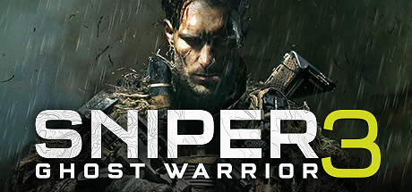

**Sniper Ghost Warrior 3 is the open-world entry in the series, set in Georgia's volatile border region where Navy SEAL Jon North hunts his missing brother. Features three distinct mission approaches: sniper, assault, or stealth.**

---

## 📖 About

Sniper Ghost Warrior 3 is the open-world entry in the series, set in Georgia's volatile border region where Navy SEAL Jon North hunts his missing brother. Features three distinct mission approaches: sniper, assault, or stealth.

## ⚠️ Problems Without Trainer

| Problem | Status |
|---------|--------|
| **Load Times** — Notoriously long loading screens between zones were a major criticism at launch | ✅ Solved |
| **Collectible Volume** — Hundreds of collectibles across an enormous open world | ✅ Solved |
| **Weapon Upgrade Grind** — Craft materials for best attachments require extensive resource collection | ✅ Solved |
| **Open World Pacing** — Large empty areas between points of interest slow traversal significantly | ✅ Solved |

## ✅ Solution

The **Sniper Ghost Warrior 3 Trainer** solves all these issues by giving you complete control over the game.

## 🎯 Full Feature List

- Unlimited Resources
- God Mode / Invincibility
- Instant Skill Cooldown
- One-Hit Kill
- Freeze Game Timer
- Unlock All Items & Achievements
- Custom Speed Multiplier
- Save State Anywhere

## 🚀 Quick Start

1. **Disable Windows Defender** temporarily (trainer may trigger false positive)
2. Download the trainer from the button above
3. Launch Sniper Ghost Warrior 3
4. Run the trainer as Administrator
5. Activate desired cheats with hotkeys

## 💎 Free vs Paid

| Feature | Free | Pro |
|---------|------|-----|
| Basic God Mode | ✅ | ✅ |
| Unlimited Resources | ✅ | ✅ |
| All Advanced Cheats | ❌ | ✅ |
| Auto-Updates | ❌ | ✅ |
| Priority Support | ❌ | ✅ |

## 💻 Requirements

- Windows 10/11 (64-bit)
- Sniper Ghost Warrior 3 (any version)
- .NET Framework 4.8+
- DirectX 11+

## 🍎 macOS

macOS users can use our alternative tool:

## ⚖️ Legal

This trainer is for educational and single-player use only. Use responsibly.

---

